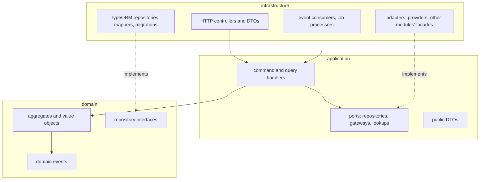
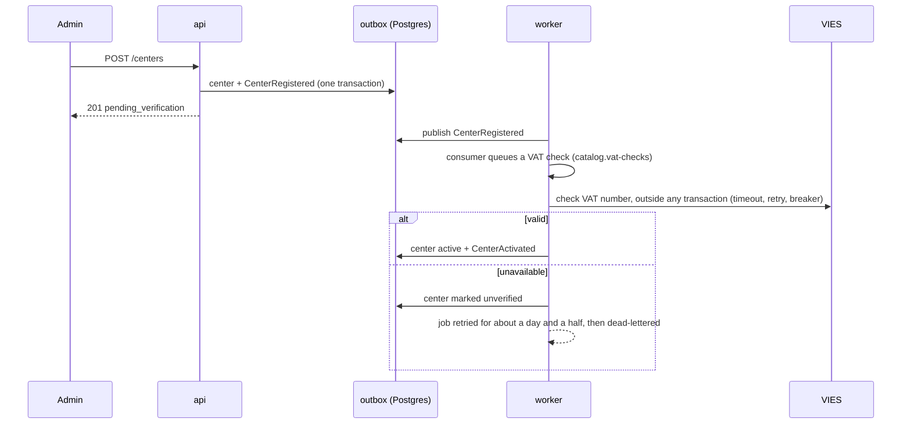
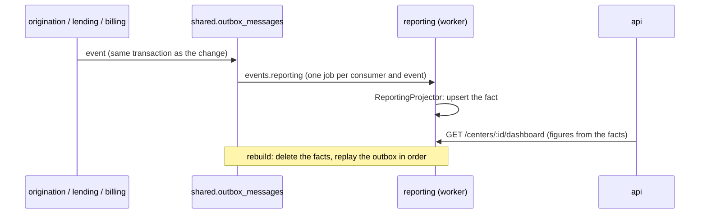

# Architecture

Tramo is a modular monolith (ADR 001) deployed as two processes built from one image.

## Containers


## Inside a module

Every module has the same three layers (ADR 002); `pnpm arch:check` fails on any import against
the arrows. Other modules reach it only through its `application/dto` (queries and commands it
publishes) and `domain/events`.



A command handler loads an aggregate, calls one method on it and saves it inside the unit of work
(ADR 003); the save writes the aggregate, with an optimistic version check, and its events to the
outbox in the same transaction. Queries read through query ports straight into DTOs.

## From a change to its effects

```mermaid
sequenceDiagram
  participant H as Command handler (api or worker)
  participant DB as Postgres
  participant P as Outbox publisher (worker)
  participant Q as BullMQ (events.<module>)
  participant C as Consumer (worker)
  H->>DB: BEGIN; save aggregate (version check); INSERT outbox_messages; COMMIT
  loop every OUTBOX_POLL_INTERVAL_MS
    P->>DB: SELECT unpublished FOR UPDATE SKIP LOCKED
    P->>Q: one job per subscribed consumer, id <eventId>.<consumer>
    P->>DB: mark published, COMMIT
  end
  Q->>C: job (attempts with backoff, then the dead-letter queue)
  C->>DB: BEGIN; INSERT processed_events (eventId, consumer); handle; COMMIT
```

A duplicate (the publisher retried after Redis accepted the jobs, or a job ran twice) finds its
`processed_events` row and does nothing, so every side effect runs once. Jobs carry the
correlation id of the request that caused them, which appears in every log line they write.

## Data model

One Postgres schema per module (ADR 008); tables refer to other modules' rows by id only, never by
foreign key. Lists are paginated on `(created_at, id)` (the ops review queue on
`(status_changed_at, id)`), each with an index in that order.

| Schema          | Tables                                                                                          | Notes                                                                                     |
| --------------- | ----------------------------------------------------------------------------------------------- | ----------------------------------------------------------------------------------------- |
| `iam`           | `users`, `refresh_tokens`, `api_keys`                                                           | Passwords as argon2id, refresh tokens and API keys as SHA-256; ended sessions pruned      |
| `catalog`       | `training_centers`, `programs`                                                                  | Payout IBAN encrypted (ADR 014); financing options as columns with CHECKs                 |
| `origination`   | `financing_applications`, `risk_policies`                                                       | Profile, verifications and the decision record (score, factors, reasons) as jsonb         |
| `lending`       | `contracts`, `disbursements`, `financing_plans`                                                 | The instalment table or ISA periods read back whole as jsonb                              |
| `billing`       | `charges`, `payment_mandates`, `income_declarations`, `declaration_reminders`, `ledger_entries` | Mandate IBAN encrypted; one charge per contract and reference; the ledger is a projection |
| `notifications` | `notification_log`, `webhook_subscriptions`, `webhook_deliveries`                               | Webhook secrets encrypted (ADR 018)                                                       |
| `reporting`     | `application_facts`, `contract_facts`, `disbursement_facts`, `charge_facts`                     | Disposable read models, rebuilt from the outbox (ADR 019)                                 |
| `shared`        | `outbox_messages`, `processed_events`, `audit_log`                                              | Kept forever; the outbox is also the event history                                        |

Money columns are integer cents with `CHECK (... >= 0)`, rates are basis points, enums are text
with CHECKs, timestamps are `timestamptz(3)`, and aggregates carry a `version`.

## Decision records

| ADR                                                                                        | Title                                                                    | Status   |
| ------------------------------------------------------------------------------------------ | ------------------------------------------------------------------------ | -------- |
| [001](adr/001-modular-monolith.md)                                                         | Modular monolith with separate api and worker processes                  | accepted |
| [002](adr/002-hexagonal-ddd-cqrs.md)                                                       | Hexagonal modules with tactical DDD and CQRS                             | accepted |
| [003](adr/003-typeorm-data-mapper-and-unit-of-work.md)                                     | TypeORM as a data mapper, unit of work through CLS                       | accepted |
| [004](adr/004-transactional-outbox-bullmq.md)                                              | Transactional outbox, BullMQ delivery, idempotent consumers              | accepted |
| [005](adr/005-money-as-integer-cents.md)                                                   | Money as integer cents, rates as basis points                            | accepted |
| [006](adr/006-problem-details-errors.md)                                                   | RFC 9457 Problem Details for every error response                        | accepted |
| [007](adr/007-testcontainers.md)                                                           | Integration and e2e tests against real Postgres and Redis                | accepted |
| [008](adr/008-schema-per-module.md)                                                        | One Postgres schema per module, no foreign keys across schemas           | accepted |
| [009](adr/009-clock-port.md)                                                               | Time comes from an injectable Clock                                      | accepted |
| [010](adr/010-uri-versioning-cursor-pagination.md)                                         | URI versioning and cursor pagination                                     | accepted |
| [011](adr/011-versioned-agent-tooling.md)                                                  | Versioned coding-agent tooling                                           | accepted |
| [012](adr/012-toolchain-nest12-commonjs-jest.md)                                           | NestJS 12 on CommonJS, TypeScript 6 and Jest                             | accepted |
| [013](adr/013-advisory-locks-for-session-families-and-startup-migrations.md)               | Advisory locks for session families and startup migrations               | accepted |
| [014](adr/014-field-level-encryption-for-payout-ibans-and-webhook-secrets.md)              | Field-level encryption for payout IBANs and webhook secrets              | accepted |
| [015](adr/015-explainable-scoring-with-versioned-risk-policies.md)                         | Explainable scoring with versioned risk policies                         | accepted |
| [016](adr/016-french-amortisation-with-per-row-rounding-and-calendar-month-isa-periods.md) | French amortisation with per-row rounding and calendar-month ISA periods | accepted |
| [017](adr/017-billing-applies-lendings-isa-rules-through-a-public-command.md)              | Billing applies lending's ISA rules through a public command             | accepted |
| [018](adr/018-outgoing-webhooks-sign-with-a-per-center-secret-kept-encrypted.md)           | Outgoing webhooks sign with a per-center secret kept encrypted           | accepted |
| [019](adr/019-reporting-read-models-are-rebuilt-from-the-outbox.md)                        | Reporting read models are rebuilt from the outbox                        | accepted |

## HTTP pipeline

Every request to the api goes through, in order: request id and CLS context, rate limiting,
validation, idempotency, the handler, auditing, and Problem Details rendering of errors.

- **Rate limiting.** A fixed window per client IP and route, counted in Redis by one Lua script so
  all api instances share the counters (`THROTTLE_LIMIT` per `THROTTLE_TTL_MS`). Credential
  routes marked `@AuthRateLimited()` (every `/auth/*` route and `POST /applications`) also count
  against `THROTTLE_AUTH_LIMIT` per minute. Health checks, `/metrics` and the provider callbacks
  (`POST /webhooks/psp`, `POST /webhooks/esign`) are exempt: a provider sends its callbacks from
  a few addresses and in bursts (a billing run, a batch of signatures), each one is authenticated
  by its HMAC signature before anything runs, and its volume follows what Tramo asked of the
  provider. Exceeding either limit returns 429 with `Retry-After`.
- **Idempotency.** Endpoints marked `@Idempotent()` require an `Idempotency-Key`. The key is
  scoped to the caller (user or API key), so idempotent routes must be authenticated. A short-lived "in progress" record (60 s) makes a
  concurrent duplicate fail fast with 409; a completed response is kept for 24 h and replayed with
  `Idempotent-Replayed: true`. The same key with a different method, path, query or body returns 422.
  Failed requests are not stored, so a client can fix the request and retry with the same key.
  The in-progress record is renewed while the handler runs; if the response cannot be stored after
  a success, the record is left to expire instead of being released: an immediate retry gets 409
  rather than running the operation a second time.
- **Audit log.** Endpoints marked `@Audited({ action, resource })` write one row to
  `shared.audit_log` per call: actor, action, resource, outcome, error code, request id and the
  changes the handler described through the `AuditTrail` port. The row is written after the
  handler's transaction, so failed and rolled-back attempts are recorded too.
- **Pagination.** Lists use keyset pagination on `(created_at, id)` with an opaque cursor
  (ADR 010; the review queue pages on `(status_changed_at, id)`, oldest first); later pages do
  not shift when new rows arrive.
- **Metrics.** `GET /metrics` (Prometheus text) answers a bearer of `METRICS_TOKEN` (32 characters
  or more; production refuses the published one); without a configured token it is a 404, and a
  wrong token a logged 401. Bare statuses, not Problem Details: its only client is a scraper. It is
  exempt from the rate limit, which counts in Redis: a scrape must not depend on the store it
  reports on. It reports `tramo_http_request_duration_seconds`
  by method, route template and status (requests no Nest route took, including Bull Board, share
  `route="unmatched"`), `tramo_queue_jobs` by queue and state, `tramo_outbox_pending_events`
  (counted up to 10,000) and `tramo_outbox_lag_seconds` (age of the oldest event not yet handed
  to the queues), plus the process defaults. The backlog is read from Redis and Postgres when
  scraped, at most every five seconds, so the api's one target covers the worker's queues too; a
  source that does not answer within five seconds is left out of that scrape instead of holding
  it.
- **Query budget.** A list page is one query, plus one batched lookup where rows need names from
  elsewhere (the catalog's center names), whatever its size; `test/e2e/query-budget.e2e-spec.ts`
  counts the statements of the catalog and of a student's applications for one row and for
  four. Each list's scope (center, student, contract, status) and its sort have an index; the
  narrower filters (modality, price, product, a delivery's status or event) are applied on top
  of it. Batch jobs work one plan (billing run) or one charge (dunning, collection) per
  transaction on purpose, so one failure does not undo or block the others.

## Authentication

- **Sessions.** Access tokens are HS256 JWTs valid for 15 minutes. Refresh tokens are opaque,
  stored as SHA-256, single use and rotated on every refresh within a family. A family ends
  `SESSION_MAX_DAYS` (90) after sign-in however often it is refreshed.
- **Reuse.** A rotated refresh token presented again more than 10 seconds after its rotation is
  treated as stolen: the whole family is revoked and `RefreshTokenReuseDetected` is published.
  Within those 10 seconds it is rejected without revocation, because it is almost always the
  legitimate client retrying a request whose response it lost.
- **Lockout.** Sign-in attempts are counted per account, not per IP, so distributed guessing
  cannot avoid them. Each attempt is checked against the lock and counted in one Redis script
  before its password is verified, so parallel requests cannot all slip past the threshold; a
  success clears the count. The cost is that anyone can lock an account by failing on purpose; the lock is
  progressive and capped at an hour, the auth routes are rate limited per client, and the attempts
  are visible in the logs. A per-IP and device-cookie scheme would reduce that risk at the price of
  more state.
- **Housekeeping.** A daily job (`iam.session-sweep`, 03:30 UTC) deletes the refresh tokens of
  sessions that ended more than 30 days earlier, in batches of 1,000 rows per transaction, along
  `ix_iam_refresh_tokens_family_expires_at`. The month of grace keeps reuse of a stolen token
  detectable after its session ended.
- **Disabling an account.** An admin disables an account with `POST /users/:id/disable`
  (audited, `UserDisabled`): it can no longer sign in, and every refresh token of every family it
  has is revoked in the same transaction, each family under its lock (ADR 013). Disabling it again
  answers 204 and changes nothing; an admin cannot disable their own account. A sign-in that read
  the account just before it was disabled can still open a session, which ends at its first
  refresh, since refreshing checks the account again.
- **API keys.** Center keys carry explicit scopes and only reach endpoints that declare them.
  Routes opened to API keys are not implicitly open to users; they must also name roles.
- **Roles.** Users only reach routes that name their roles with `@Roles`; a route that forgets it
  refuses every user, since anyone can register as a student.
- **Rate limits.** Clients are counted per IPv4 address and per IPv6 /64 network. The queue
  dashboard (`/admin/queues`) sits outside Nest's guards and limits failed sign-ins itself (ten
  per client per 15 minutes).

Known gaps, accepted for now:

- `POST /auth/register` answers 409 for an email that already has an account, so registration
  reveals which emails are registered. Answering the same way in both cases needs an email
  confirmation step (a link the notifications module would send), which does not exist yet; until
  then the auth rate limit slows enumeration down.
- `StudentRegistered` and `CenterUserCreated` carry the email address (the first for the welcome
  email, which is sent before anything else knows the user). Their jobs (and Bull Board, behind
  its own credentials) therefore hold it until completed jobs expire after seven days.
- An admin sets a new center administrator's first password. Production needs an invitation
  link, or a forced change on first sign-in, so the admin does not keep a working password.
- Requests are authenticated from the access token alone (`JwtStrategy` does not read the user
  row), so a disabled account keeps the access tokens it already holds until they expire, at most
  15 minutes. Its refresh tokens stop working at once. Closing that window needs a revocation
  list or a user lookup on every request.
- There is no password change or reset. A user who loses their password, or whose password
  leaked, can only be disabled by an admin.

## Catalog

Training centers and the programs students finance.

- **Center lifecycle.** An admin registers a center (`pending_verification`). The
  `CenterRegistered` consumer only queues a VAT check on `catalog.vat-checks`; that job asks VIES
  outside any transaction and saves the answer in a short one. A valid number activates the
  center. While VIES cannot answer, the center is marked `unverified` and the job is retried for
  about a day and a half (exponential from one minute) before it is dead-lettered; ops can also
  ask again with `POST /centers/:id/verify-vat`. A number that stops being valid leaves an active
  center active and emits `CenterVatInvalidated` for ops to decide. Only an admin changes a
  center's fee, payout account or status, and each change is an event (`CenterRenamed`,
  `CenterPlatformFeeChanged`, `CenterPayoutAccountChanged`, `CenterSuspended`...).
- **Correcting a VAT number.** A center registered with a wrong number is not stuck: while it is
  not active an admin sends `country` and `taxId` in `PATCH /centers/:id`. The number must not
  belong to another center (409 `center_already_registered`), the previous validation is dropped
  and `CenterVatNumberChanged` queues a check of the new number, as registration does. An active
  center's number is the one VIES confirmed (409 `center_vat_number_locked`): suspend it first.
  Reinstating a suspended center without a valid number returns it to `pending_verification` and
  `CenterReturnedToVerification` queues a new check, since a check that ended `invalid` is not
  retried on its own. A check answered for a number the center no longer has is dropped.
- **VIES client.** Each attempt has a timeout; transient failures and timeouts are retried twice
  with backoff, and a circuit breaker stops calling for 30 s after five failures in a row. Every
  failure becomes an `unavailable` answer: a registry outage never fails a request. `VIES_MODE`
  selects VIES, its test service or a local fake; production accepts only VIES.
- **Payout IBAN.** Stored encrypted (AES-256-GCM, ADR 014) and bound to its row, with its last four
  characters in clear; responses, events, logs and the audit log only show the masked value.
- **Programs.** Created as drafts and published once they have a financing option (instalment
  terms of 6 to 48 months, or an income share agreement capped at 1.0 to 2.0 times the price,
  offered only when at least 60 % of graduates find a job) and their center is active. The same
  rules are CHECK constraints on `catalog.programs`, and request validation reads its bounds from
  the domain. A `PATCH` that changes details and financing is checked once, as the program ends
  up (`Program.revise`): dropping the ISA while lowering the employability rate below 60 % is one
  valid change. Changes to a published program are announced in full (`ProgramDetailsChanged`,
  `ProgramFinancingChanged`) so other modules keep their own copy. While a center is suspended,
  only Tramo admins change its programs.
- **Public catalog.** `GET /programs` reads a SQL read model that maps rows straight to DTOs:
  published programs of active centers, filtered by center, modality, product and price, newest
  first with keyset pagination on a partial index.
- **Optional authentication.** `GET /programs/:id` is open to anonymous callers and also reads
  the credentials when they are sent (`@OptionalAuthentication()`), so whoever manages a program
  sees it while it is a draft or archived: the center's admins, its API keys and Tramo admins
  (ops do not manage programs); everybody else gets a 404.
  Invalid credentials are still rejected, but the route is public to the authorization guard, which
  therefore checks no roles or scopes: the use case does (`canSeeUnpublishedPrograms` requires
  `programs:read` or `programs:write` from an API key). Any new optional route has to do the same.



## Origination

Financing applications, from the student's draft to an accepted offer.

- **Lifecycle.** `draft → submitted → verifying → scoring → approved | needs_review | rejected`;
  ops settle `needs_review` with a reason; the student accepts an approval (`offer_accepted`,
  which lending picks up) or cancels anything not final. An application nobody has touched for
  14 days (no change of status, no edit of the draft) expires, through an hourly sweep in the
  worker; one waiting for an analyst does not, the review queue being ops' backlog. A student
  has at most one open application per program (a partial unique index), so two offers for one
  course cannot both be accepted. An accepted offer follows its contract: lending's
  `ContractCancelled` moves it to `withdrawn` (`origination.withdraw-application`) and
  `ContractCompleted` to `closed` (`origination.close-application`), both final and freeing the
  program for a new application; a defaulted contract keeps it held.
- **Who does what.** A student applies for themselves; a training center's integration (API key
  with `applications:write`) starts a draft for a student of its own programs, who must already
  have an account (`FindStudentQuery`, iam's public query). The center picks the program and the
  financing; the personal data comes from the student, who alone submits (consenting to the
  checks), cancels and accepts. The center sees status and program, not the profile, the score or
  the decision explanation; staff see everything, but an analyst cannot decide their own
  application. Submitting, accepting and cancelling are audited.
- **Program snapshot.** The program is copied from the catalog (`FindPublishedProgramQuery`) when
  the draft starts and again on submit, and must still be open when the offer is accepted: price
  and options changed later in the catalog do not change an application in flight, and the
  accepted terms travel in `OfferAccepted`.
- **Verification saga.** `ApplicationSubmitted` → a consumer queues three jobs on
  `origination.verifications` (`kyc.verify`, `employment.fetch`, `bureau.check`, job id
  `<applicationId>.<provider>`), writing nothing itself. Each job asks its provider outside any
  transaction, then records the answer (`VerificationCompleted`, with how many remain); the first
  answer moves the application to `verifying`, the third to `scoring`. The jobs run in parallel
  and a lost optimistic lock is retried on the fresh version without asking the provider again.
  The consumer of the last `VerificationCompleted` scores it. A provider outage is retried for
  about two hours, then dead-lettered.
- **Providers.** KYC, employment history ("vida laboral") and credit bureau are ports with
  simulated adapters: deterministic by national id (ending in 9 fails KYC, ending in 7 is in a
  default registry, the rest derived from a hash) with a configurable latency. They verify any
  national id, so a production process refuses to start with them; real providers replace the
  adapters, not the ports.
- **Scoring (ADR 015).** `ScoringEngine` is a pure function of the application, its
  verifications and the `RiskPolicy` in force: five hard rules (age, residence, identity, default
  registry, amount above the limit) reject outright; otherwise the score is
  `40·employability + 25·history + 20·affordability + 15·bureau` (weights and thresholds from the
  policy, version 1: approve from 70, review from 50, up to 12,000 EUR). Affordability compares the
  estimated payment with the declared income, but never more income than the employment record
  shows; an ISA, paid as a share of future income, is judged by that share. The `DecisionRecord`
  keeps every factor with its weight and value, readable reasons and the policy version.
- **Personal data.** The national id is encrypted and bound to its row (ADR 014); responses show
  it masked, logs redact it and the rest of the profile, and events carry ids, outcomes and
  reason codes, never the profile, the score or the readable reasons.

Known gaps, accepted for now:

- A center's API key learns whether an email belongs to a student (`student_not_found` against a
  new draft). The route has the credential-endpoint rate limit; an invitation the student accepts
  would close it.
- Nothing ties the national id to the account that applies with it: binding identity is the real
  KYC provider's job (document and selfie), which the simulated one does not do.
- The idempotency cache keeps the response of `POST /applications` (with the student's profile)
  in Redis for 24 hours.

```mermaid
sequenceDiagram
  participant Student
  participant Api as api
  participant Outbox as outbox (Postgres)
  participant Worker as worker
  participant Providers as KYC / employment / bureau
  Student->>Api: POST /applications/:id/submit
  Api->>Outbox: application submitted + ApplicationSubmitted
  Worker->>Outbox: publish; consumer queues kyc.verify, employment.fetch, bureau.check
  par each job, outside any transaction
    Worker->>Providers: ask
    Worker->>Outbox: answer recorded + VerificationCompleted
  end
  Worker->>Outbox: third answer: scoring; consumer scores with the policy in force
  Worker->>Outbox: approved | needs_review | rejected + event
  Student->>Api: GET /applications/:id/decision
```

## Lending

Contracts drawn up from accepted offers, their signature, the payment to the training center and
the repayment plan.

- **Contract.** `draft → sent_for_signature → signed → active → completed`; a contract not yet
  signed is cancelled when the student declines or the envelope expires (`defaulted` comes with
  billing's dunning). One per accepted offer (unique application id). Its terms are fixed when it
  is drawn up: the principal (the program price), the center's platform fee at that moment, and
  the product as accepted (term and TIN, or the ISA's share, threshold, payments, cap and grace).
- **Signature.** `ContractCreated` → a job renders the contract text, hashes it (SHA-256) and
  sends the envelope to the e-signature provider; the text is stored with the envelope, so `GET
/contracts/:id/document` serves what the student signs whatever the code renders later. The
  provider calls back on `POST /webhooks/esign`, authenticated by
  `X-Esign-Signature: t=<unix>,v1=<HMAC-SHA256 of "<t>.<raw body>">` (`ESIGN_WEBHOOK_SECRET`,
  and `ESIGN_WEBHOOK_PREVIOUS_SECRET` during a rotation), checked in a guard before the body is
  validated or reaches a command; a signature older than five minutes is refused, so a captured
  callback cannot be replayed later. A completed envelope must carry the hash of the document sent
  (`signature_mismatch` otherwise) and a signing time within the life of the envelope. Repeated
  callbacks write nothing; each one that changes a contract is in the audit log. A callback for an
  envelope not recorded yet is answered 409, which providers retry.
- **Disbursement.** `ContractSigned` → one disbursement per contract of the principal less the
  platform fee, `pending → sent → settled | failed`. A job reads the center's payout account
  through catalog (the only module allowed to ask for the full IBAN, by a dependency rule) and
  records it, encrypted, before calling the bank outside any transaction with the idempotency key
  `<disbursementId>.<attempt>`. From then on the attempt may have paid: a repeated run sends the
  same key to the same account, and only the bank's answer can fail it. An inactive center, or one
  without a payout account, fails the attempt before anything is sent. `DisbursementSent` queues a
  check of the settlement, retried with backoff for about a day and a half while the bank says
  pending. Ops see failures in `GET /ops/disbursements?status=failed` and send them again with
  `POST /ops/disbursements/:id/retry`, a new attempt with a new key (the account is read again, so
  a corrected IBAN is used). A disbursement whose jobs ran out stays `pending` or `sent`; ops
  reconcile it with `POST /ops/disbursements/:id/reconcile`, which sends a pending attempt again
  with its key or asks the bank about a sent one. Both are audited.
- **Repayment.** Billing collects (see Billing) and lending follows it: `ChargePaid` marks an
  instalment paid (in any order: a retried one may come after the next) or settles a payoff;
  `ContractInArrears` and `ArrearsCleared` move the contract into and out of `in_arrears`;
  `ChargeWrittenOff` defaults it (`ContractDefaulted`), which closes its plan (`defaulted`): the
  schedule shows it ended and billing no longer bills it. A payoff is refused while an instalment
  due is unpaid, since billing is already collecting it.
- **Activation and plan.** `DisbursementSettled` activates the contract on that day;
  `ContractActivated` opens its plan (ADR 016): the instalment table, stored with the plan, or
  the ISA terms with their running totals, assessed month by month without gaps. `PlanCompleted`
  completes the contract.
- **Payoff.** For instalments, `POST /contracts/:id/payoff-quote` gives what repaying everything
  costs today or on a day in the coming month; `POST /contracts/:id/payoff` takes today's quote
  (the plan refuses another amount with `payoff_quote_changed`) and records it
  (`PayoffRequested`); billing collects it and the plan ends as `paid_off`.
- **Who sees what.** The student sees the contract, its document, schedule and payoff; the center
  (its admins, or an API key with `portfolio:read`) sees the contract with its terms (the same as
  its program's financing options) and what it is paid, not the schedule, the payoff or the
  document; staff see everything. The student does not see the platform fee.
- **Providers.** E-signature and bank are ports with simulated adapters: the envelope id derives
  from the contract, and transfers to an IBAN ending in 0000 bounce (`account_closed`).
  `pnpm esign:sign <contractId>` plays the student signing against a local stack. A production
  process refuses to start with them.

Known gaps, accepted for now:

- An ISA cannot be paid off early; the cap is its limit.
- The envelope request carries the student's id only; a real provider needs their name and email,
  read through a public query of iam when one is wired in. Cancelling a contract does not void the
  envelope at the provider.
- A payout IBAN changed after signing is used for the transfer at once; a hold on changes while a
  disbursement is pending would need a second approval.
- `eventId` of the callbacks is not stored: replays are absorbed by the idempotent transitions.

```mermaid
sequenceDiagram
  participant Student
  participant Api as api
  participant Worker as worker
  participant ESign as e-signature provider
  participant Bank as bank
  Student->>Api: POST /applications/:id/accept-offer
  Api->>Worker: OfferAccepted (outbox)
  Worker->>Worker: draw up the contract; ContractCreated
  Worker->>ESign: send envelope (document + SHA-256)
  ESign->>Api: POST /webhooks/esign (signed callback)
  Api->>Worker: ContractSigned (outbox)
  Worker->>Bank: transfer principal − fee (key <disbursementId>.<attempt>)
  Worker->>Bank: settled? (retried while pending)
  Worker->>Worker: DisbursementSettled → contract active → plan opened
  Student->>Api: GET /contracts/:id/schedule
```

## Billing

Collection of what students owe: SEPA direct debit mandates, the monthly cycle, collection
through a payment provider, dunning, ISA income declarations and the account statement.

- **Mandate.** The student authorises the debit of a contract from an account
  (`POST /contracts/:id/mandate`, from signature on); the IBAN is encrypted and bound to its row
  (ADR 014) and shown masked. A new mandate revokes the one in force, and collects at once the
  charges that fell due while the contract had none, scheduled or already overdue.
- **Cycle.** `billing.cycle` on the 1st and the 5th at 03:00 UTC, or
  `POST /ops/billing/run?asOf=` for a demo or a catch-up (`&contractId=` for one contract; a day
  still to come only where `BILLING_FUTURE_RUNS_ENABLED`, off in production): for every plan
  being repaid (`ListBillablePlansQuery` of lending, which leaves out a plan whose payoff is
  being collected), a charge for each instalment falling due by the end of the month, and for an
  ISA each month of income whose declarations have closed (on the 5th of the next month),
  assessed by the rules of lending on the income declared (ADR 017) and due that day, until the
  month that ends the plan. A charge
  billed late is due on the day of the run, so dunning counts from when the student could pay.
  Charges are unique per contract and reference (`installment:3`, `isa:2026-07`,
  `payoff:<request>`): a second run creates nothing. One plan per transaction; the run goes on
  past the plans it cannot bill, reports them, and the scheduled job then fails so it shows on
  the dashboard and is retried. Collection and dunning do the same per charge.
- **Collection.** Every morning (`billing.collect`) the charges due are submitted under the
  mandate in force: each attempt has its key, `<chargeId>.<attempt>`, and records the mandate
  it uses, so a repeated provider call sends the same request and is never collected twice. The
  provider accepts at once and answers later on `POST /webhooks/psp`, signed like the
  e-signature callbacks (`PSP_WEBHOOK_SECRET`), echoing the key and its payment id, which must
  be the one the provider accepted for the attempt; the answer is audited and a repeated one
  writes nothing. A charge without a mandate stays scheduled and dunning chases it. Whether a
  payment clears the arrears of a contract is decided under a lock on the contract, so two
  payments at once cannot both see the other unpaid.
- **Dunning.** Every morning (`billing.dunning`), or `POST /ops/dunning/run?asOf=`, every
  charge not settled moves through the steps it has reached, each applied once: a reminder three
  days before (`ChargeDueSoon`), a notice the day after (`ChargeOverdue`, the charge
  `overdue`), collection retried at 3 and 7 days, a second notice at 15, arrears at 30
  (`ContractInArrears`, the contract `in_arrears` and its center told) and at 90 the charge
  written off and the contract defaulted. Once the contract has defaulted its debt goes to
  recovery: its other charges still get their notices and are written off in turn, but
  collection is not retried. A payment that leaves nothing of the contract in
  arrears clears them (`ArrearsCleared`); lending applies these notices in the order billing
  saw them, whatever the order they arrive in. A charge being collected waits for the answer.
  Ops collect a failed or overdue charge again with `POST /charges/:id/retry`, or ask the
  provider again for one stuck in collection (same key, a new job), unless the contract
  defaulted. Declarations and the ISA step of the cycle take the same lock on the contract, so
  a declaration cannot land in a month being assessed without it.
- **ISA declarations.** `POST /contracts/:id/income-declarations`, one per month, from its first
  day until the end of the 4th of the next month (a salary paid on the 1st or 2nd is declared in
  time) and while lending has not assessed it (`period_not_open` otherwise: on the 5th the cycle
  assesses the month, paused when undeclared); audited, the amount stays in billing (events say
  only that a month was declared). On the 25th students who have not declared the month are
  reminded once (`IncomeDeclarationDue`).
- **Payoff.** `PayoffRequested` from lending becomes a charge due that day, collected at once
  and never dunned; meanwhile nothing else of the contract is collected or dunned, since it
  covers what is left. Paid, the plan ends (`paid_off`) and every charge not collected is
  cancelled, overdue ones included; a defaulted contract has only those not yet due cancelled,
  and a plan that ends on its last instalment or ISA payment keeps its last charge. Refused, or
  impossible without a mandate, the charge is cancelled and lending withdraws the payoff
  (`PayoffWithdrawn`): a job on `billing.cycle` bills and collects the contract as of that day,
  one plan and one charge per transaction as in the scheduled runs (the job fails and is retried
  while any of them fails), and the student may ask again, which is a new charge.
- **Statement.** `GET /contracts/:id/statement`: a projection of the charge events (charge,
  payment, write-off, cancellation), one line per event, with the running balance; charges in
  `GET /contracts/:id/charges`. The student and staff see them; centers see their portfolio in
  aggregate.
- **Provider.** Simulated: deterministic by key, it answers `SIMULATED_PSP_DELAY_MS` later
  through a queue the worker posts from (`PSP_CALLBACK_URL`), refusing amounts that end in 13
  cents (`insufficient_funds`). A production process refuses to start with it.

Known gaps, accepted for now:

- A charge whose provider never answers stays pending; dunning waits for it, and ops ask the
  provider again with the retry endpoint.
- The mandate's account is not checked to belong to the student: the provider's mandate
  confirmation (or an account ownership check) would do it before the first debit.
- An instalment already in collection when the payoff is requested is part of the quote too: if
  both are collected, the student has paid it twice and ops refund the difference.
- Income declarations come from the student only; the employment history provider could confirm
  them (`source: employment_provider`).
- A charge written off counts towards an ISA cap; it only happens with the default, after which
  the plan is no longer billed.

```mermaid
sequenceDiagram
  participant Ops as cycle (1st, 5th) / ops
  participant Billing as billing (worker)
  participant Lending as lending
  participant PSP as payment provider
  participant Api as api
  Ops->>Billing: run the cycle as of a day
  Billing->>Lending: ListBillablePlansQuery; AssessIsaPeriodCommand (same transaction, planEnded stops)
  Billing->>Billing: charges; collect what is due under the mandate (ChargeSubmitted)
  Billing->>PSP: collect (key <chargeId>.<attempt>)
  PSP->>Api: POST /webhooks/psp (signed, echoes the key)
  Api->>Lending: ChargePaid (outbox): instalment paid, payoff settled; ChargeFailed: payoff withdrawn
  Ops->>Billing: dunning: notices, retries, arrears at 30 days, default at 90
```

## Notifications

Emails to students and centers, and signed webhooks to centers. Everything it sends is caused by
an event of another module; it decides nothing.

- **Emails.** A consumer per event writes an email down in `notifications.notification_log` (one
  per event, template and recipient: a redelivered event writes nothing), with the template's
  values (ids, amounts, dates) and the id it is about as `reference`. `EmailRequested` has a job
  (`notifications.emails`, five attempts with backoff) render it from its handlebars template and
  hand it to the SMTP server (Mailpit locally, `SMTP_*`; encrypted in production, and whenever
  credentials are sent); a sent email is not sent again, one that runs out of attempts is
  `failed` and its job dead-lettered, and an hourly sweep (one attempt: the next hour is its
  retry) gives up those still pending a day later (their job was lost). Failures are recorded and published as categories (`smtp_550`,
  `timeout`), never the server's text, which quotes the recipient. Sending is at least once: an
  answer lost after the server accepted the message sends it again. Recipients are looked up in
  iam when the email is written (`FindUserContactQuery`, `ListCenterContactsQuery`); the
  welcome email goes to the address the registration carried, and never repeats it in its body.
  An address is one mailbox: `Email` refuses list and display-name characters.

  | Event                      | Email                      | To                         |
  | -------------------------- | -------------------------- | -------------------------- |
  | `StudentRegistered`        | `welcome`                  | the student                |
  | `ApplicationSubmitted`     | `application_received`     | the applicant              |
  | `ApplicationApproved`      | `application_decided`      | the applicant              |
  | `ApplicationRejected`      | `application_decided`      | the applicant (no reasons) |
  | `ContractSentForSignature` | `contract_ready_to_sign`   | the student                |
  | `DisbursementSettled`      | `disbursement_settled`     | the center's admins        |
  | `ChargeDueSoon`            | `installment_reminder`     | the student                |
  | `ChargePaid`               | `installment_collected`    | the student                |
  | `ChargeOverdue`            | `payment_overdue`          | the student                |
  | `ContractInArrears`        | `contract_in_arrears`      | the student                |
  | `IncomeDeclarationDue`     | `isa_declaration_reminder` | the student                |
  | `IsaDeclarationOverdue`    | `isa_declaration_overdue`  | the student                |

- **Webhooks.** A center's admin points its webhook at a URL (`PUT /centers/:id/webhook`) and
  receives a secret once (ADR 018). Six events are posted: `application.submitted`,
  `application.decided`, `contract.signed`, `disbursement.settled`, `contract.in_arrears`,
  `contract.defaulted`, with ids, amounts and states, never the student's personal data. Each is
  a delivery (one per center and event), posted by a job (`notifications.webhooks`) signed with
  `X-Tramo-Signature`, with `X-Tramo-Delivery-Id` and `X-Tramo-Event`; five attempts per round
  with exponential backoff from `WEBHOOK_RETRY_DELAY_MS`, then `failed` and dead-lettered. The
  center sees them in `GET /centers/:id/webhook-deliveries`, with the status or the category
  of each failure, and asks for one again with `POST .../webhook-deliveries/:deliveryId/redeliver`
  (a new round; ops can too). A round whose job was lost (no attempt for 15 minutes) can be
  redelivered too, and a job that fails before posting on its last attempt closes its round.
  Removing the webhook (idempotent) stops new deliveries; those still pending are given up when
  their job next runs. In production only
  https to public addresses is posted, checked at configuration and on the address each
  connection uses (ADR 018); the compose stack points centers at the webhook sink. The audit
  entry of a configuration keeps the old and new URL, never the secret, and its answer is not
  cached (`Cache-Control: no-store`).

Known gaps, accepted for now:

- Deliveries share the worker's slots: a center whose endpoint stalls for the whole timeout
  slows the others down. A per-center concurrency cap, or a circuit breaker after several failed
  rounds, would isolate it.
- Emails are in English only, and a student who changes address after an email was written
  receives it at the old one.
- `notification_log` keeps recipients' addresses indefinitely; a retention job would trim it.

```mermaid
sequenceDiagram
  participant Module as lending / billing / origination
  participant Notif as notifications (worker)
  participant Iam as iam
  participant SMTP as SMTP (Mailpit)
  participant Center as center endpoint
  Module->>Notif: event (outbox)
  Notif->>Iam: FindUserContactQuery / ListCenterContactsQuery
  Notif->>Notif: email written down (EmailRequested); delivery written down (WebhookDeliveryRequested)
  Notif->>SMTP: send (job notifications.emails)
  Notif->>Center: POST signed (job notifications.webhooks, 5 attempts per round)
  Center-->>Notif: 2xx (delivered) or anything else (retried, then failed)
```

## Reporting

The read side: dashboards for centers and operations, built from the events of the other
modules (ADR 019). It decides nothing and owns no aggregate.

- **Facts.** One row per application, contract, disbursement and charge in the `reporting`
  schema, written by a consumer per event through `ReportingProjector`. The upserts give the same
  facts whatever the order and repetition of events: each event sets what it knows; the status
  follows the most recent event but a final one (a contract completed, defaulted or cancelled, a
  charge paid, written off or cancelled, an application rejected, accepted, cancelled or
  expired) is never replaced by one that is not; the decision is set once; a charge keeps the
  day of its latest failure. A charge whose events never named the center is placed by its
  contract's.
- **Figures.** Pure functions of the domain over rows the store groups, computed when asked:
  - `GET /centers/:id/dashboard` (the center's admins, its API keys with `portfolio:read`,
    staff): applications submitted (drafts are not in the funnel) by where they are now (an
    accepted offer stays accepted whatever its contract does next; contracts count that),
    contracts by state, in total and by product, money disbursed (settled transfers), collected,
    outstanding (charged, not collected; a payoff being collected is left out, it covers the
    charges still open) and written off, and the delinquency rate (contracts in arrears among
    those being repaid).
  - `GET /centers/:id/programs/:programId/performance`: applications, approval rate (approved
    among decided), mean ticket, and the mean score of the applicants, which origination gives
    only from ten scored applicants and in bands of five (`GetProgramScoresQuery`): scores stay
    there. A program of another center is a 404.
  - `GET /ops/overview` (staff): applications waiting for an analyst, charges whose collection
    failed today and are still unpaid, transfers to centers pending or failed, contracts in
    arrears, jobs in the dead-letter queue. The queue connection waits for Redis instead of
    failing, so the count is given up after two seconds: while Redis is down `deadLetters` is
    `null` and the rest still answers.
- **Rebuild.** `POST /ops/reporting/rebuild` queues `reporting.rebuild` (one at a time; a request
  while one is queued or running answers 202 `{"queued": false}`). When the queue does not answer
  within two seconds (Redis down) it answers 503 `queue_unavailable` and the client retries. In one
  REPEATABLE READ transaction the facts are locked against writers (readers still see the old
  ones), deleted, and the history of events, read from the outbox (`EventHistory`), is replayed
  through the same projector. A deployment that adds reporting to existing data runs it once.

Known gaps, accepted for now:

- The outbox is never pruned while it is the history; an archive of published events would keep
  it small (ADR 019).
- Figures are aggregated per request and a rebuild is one transaction: fine for the demo's
  volume, a portfolio of millions of rows would want summary tables and a shadow rebuild.


