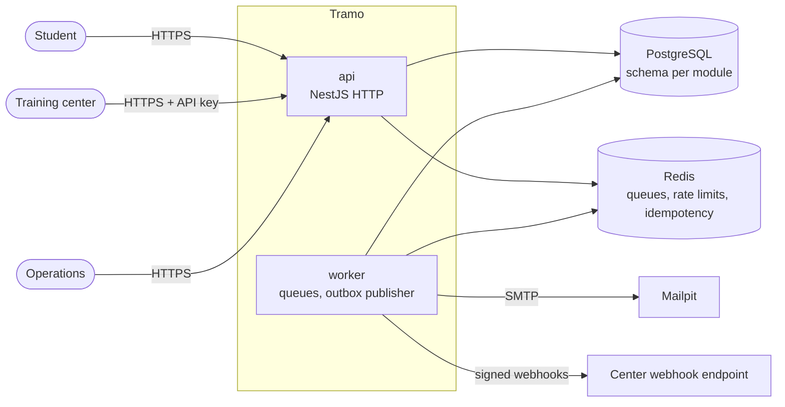
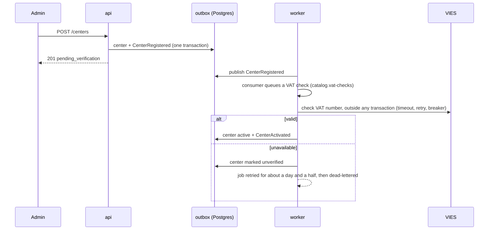

# Architecture

Tramo is a modular monolith (ADR 001) deployed as two processes built from one image.

## Containers



## Decision records

| ADR                                                                                        | Title                                                                    | Status   |
| ------------------------------------------------------------------------------------------ | ------------------------------------------------------------------------ | -------- |
| [001](adr/001-modular-monolith.md)                                                         | Modular monolith with separate api and worker processes                  | accepted |
| [002](adr/002-hexagonal-ddd-cqrs.md)                                                       | Hexagonal modules with tactical DDD and CQRS                             | accepted |
| [003](adr/003-typeorm-data-mapper-and-unit-of-work.md)                                     | TypeORM as a data mapper, unit of work through CLS                       | accepted |
| [004](adr/004-transactional-outbox-bullmq.md)                                              | Transactional outbox, BullMQ delivery, idempotent consumers              | accepted |
| [005](adr/005-money-as-integer-cents.md)                                                   | Money as integer cents, rates as basis points                            | accepted |
| [006](adr/006-problem-details-errors.md)                                                   | RFC 9457 Problem Details for every error response                        | accepted |
| [007](adr/007-testcontainers.md)                                                           | Integration and e2e tests against real Postgres and Redis                | accepted |
| [008](adr/008-schema-per-module.md)                                                        | One Postgres schema per module, no foreign keys across schemas           | accepted |
| [009](adr/009-clock-port.md)                                                               | Time comes from an injectable Clock                                      | accepted |
| [010](adr/010-uri-versioning-cursor-pagination.md)                                         | URI versioning and cursor pagination                                     | accepted |
| [011](adr/011-versioned-agent-tooling.md)                                                  | Versioned coding-agent tooling                                           | accepted |
| [012](adr/012-toolchain-nest12-commonjs-jest.md)                                           | NestJS 12 on CommonJS, TypeScript 6 and Jest                             | accepted |
| [013](adr/013-advisory-locks-for-session-families-and-startup-migrations.md)               | Advisory locks for session families and startup migrations               | accepted |
| [014](adr/014-field-level-encryption-for-payout-ibans-and-webhook-secrets.md)              | Field-level encryption for payout IBANs and webhook secrets              | accepted |
| [015](adr/015-explainable-scoring-with-versioned-risk-policies.md)                         | Explainable scoring with versioned risk policies                         | accepted |
| [016](adr/016-french-amortisation-with-per-row-rounding-and-calendar-month-isa-periods.md) | French amortisation with per-row rounding and calendar-month ISA periods | accepted |
| [017](adr/017-billing-applies-lendings-isa-rules-through-a-public-command.md)              | Billing applies lending's ISA rules through a public command             | accepted |

## HTTP pipeline

Every request to the api goes through, in order: request id and CLS context, rate limiting,
validation, idempotency, the handler, auditing, and Problem Details rendering of errors.

- **Rate limiting.** A fixed window per client IP and route, counted in Redis by one Lua script so
  all api instances share the counters (`THROTTLE_LIMIT` per `THROTTLE_TTL_MS`). Routes declare
  stricter limits with `@Throttle`; health checks are exempt. Exceeding the limit returns 429 with
  `Retry-After`.
- **Idempotency.** Endpoints marked `@Idempotent()` require an `Idempotency-Key`. The key is
  scoped to the caller (user or API key), so idempotent routes must be authenticated. A short-lived "in progress" record (60 s) makes a
  concurrent duplicate fail fast with 409; a completed response is kept for 24 h and replayed with
  `Idempotent-Replayed: true`. The same key with a different method, path or body returns 422.
  Failed requests are not stored, so a client can fix the request and retry with the same key.
  The in-progress record is renewed while the handler runs; if the response cannot be stored after
  a success, the record is left to expire instead of being released: an immediate retry gets 409
  rather than running the operation a second time.
- **Audit log.** Endpoints marked `@Audited({ action, resource })` write one row to
  `shared.audit_log` per call: actor, action, resource, outcome, error code, request id and the
  changes the handler described through the `AuditTrail` port. The row is written after the
  handler's transaction, so failed and rolled-back attempts are recorded too.
- **Pagination.** Lists use keyset pagination on `(created_at, id)` with an opaque cursor
  (ADR 010); later pages do not shift when new rows arrive.

## Authentication

- **Sessions.** Access tokens are HS256 JWTs valid for 15 minutes. Refresh tokens are opaque,
  stored as SHA-256, single use and rotated on every refresh within a family. A family ends
  `SESSION_MAX_DAYS` (90) after sign-in however often it is refreshed.
- **Reuse.** A rotated refresh token presented again more than 10 seconds after its rotation is
  treated as stolen: the whole family is revoked and `RefreshTokenReuseDetected` is published.
  Within those 10 seconds it is rejected without revocation, because it is almost always the
  legitimate client retrying a request whose response it lost.
- **Lockout.** Sign-in attempts are counted per account, not per IP, so distributed guessing
  cannot avoid them. Each attempt is checked against the lock and counted in one Redis script
  before its password is verified, so parallel requests cannot all slip past the threshold; a
  success clears the count. The cost is that anyone can lock an account by failing on purpose; the lock is
  progressive and capped at an hour, the auth routes are rate limited per client, and the attempts
  are visible in the logs. A per-IP and device-cookie scheme would reduce that risk at the price of
  more state.
- **API keys.** Center keys carry explicit scopes and only reach endpoints that declare them.
  Routes opened to API keys are not implicitly open to users; they must also name roles.
- **Roles.** Users only reach routes that name their roles with `@Roles`; a route that forgets it
  refuses every user, since anyone can register as a student.
- **Rate limits.** Clients are counted per IPv4 address and per IPv6 /64 network. The queue
  dashboard (`/admin/queues`) sits outside Nest's guards and limits failed sign-ins itself (ten
  per client per 15 minutes).

Known gaps, accepted for now:

- `POST /auth/register` answers 409 for an email that already has an account, so registration
  reveals which emails are registered. Answering the same way in both cases needs an email
  confirmation step, which comes with the notifications module; until then the auth rate limit
  slows enumeration down.
- `StudentRegistered` and `CenterUserCreated` carry the email address, because the notifications
  module sends to it. Their jobs (and Bull Board, behind its own credentials) therefore hold it
  until completed jobs expire after seven days.
- An admin sets a new center administrator's first password. Production needs an invitation
  link, or a forced change on first sign-in, so the admin does not keep a working password.

## Catalog

Training centers and the programs students finance.

- **Center lifecycle.** An admin registers a center (`pending_verification`). The
  `CenterRegistered` consumer only queues a VAT check on `catalog.vat-checks`; that job asks VIES
  outside any transaction and saves the answer in a short one. A valid number activates the
  center. While VIES cannot answer, the center is marked `unverified` and the job is retried for
  about a day and a half (exponential from one minute) before it is dead-lettered; ops can also
  ask again with `POST /centers/:id/verify-vat`. A number that stops being valid leaves an active
  center active and emits `CenterVatInvalidated` for ops to decide. Only an admin changes a
  center's fee, payout account or status, and each change is an event (`CenterRenamed`,
  `CenterPlatformFeeChanged`, `CenterPayoutAccountChanged`, `CenterSuspended`...).
- **VIES client.** Each attempt has a timeout; transient failures and timeouts are retried twice
  with backoff, and a circuit breaker stops calling for 30 s after five failures in a row. Every
  failure becomes an `unavailable` answer: a registry outage never fails a request. `VIES_MODE`
  selects VIES, its test service or a local fake; production accepts only VIES.
- **Payout IBAN.** Stored encrypted (AES-256-GCM, ADR 014) and bound to its row, with its last four
  characters in clear; responses, events, logs and the audit log only show the masked value.
- **Programs.** Created as drafts and published once they have a financing option (instalment
  terms of 6 to 48 months, or an income share agreement capped at 1.0 to 2.0 times the price,
  offered only when at least 60 % of graduates find a job) and their center is active. The same
  rules are CHECK constraints on `catalog.programs`, and request validation reads its bounds from
  the domain. Changes to a published program are announced in full (`ProgramDetailsChanged`,
  `ProgramFinancingChanged`) so other modules keep their own copy. While a center is suspended,
  only Tramo admins change its programs.
- **Public catalog.** `GET /programs` reads a SQL read model that maps rows straight to DTOs:
  published programs of active centers, filtered by center, modality, product and price, newest
  first with keyset pagination on a partial index.
- **Optional authentication.** `GET /programs/:id` is open to anonymous callers and also reads
  the credentials when they are sent (`@OptionalAuthentication()`), so a center sees its own drafts.
  Invalid credentials are still rejected, but the route is public to the authorization guard, which
  therefore checks no roles or scopes: the use case does (`canSeeUnpublishedPrograms` requires
  `programs:read` or `programs:write` from an API key). Any new optional route has to do the same.



## Origination

Financing applications, from the student's draft to an accepted offer.

- **Lifecycle.** `draft → submitted → verifying → scoring → approved | needs_review | rejected`;
  ops settle `needs_review` with a reason; the student accepts an approval (`offer_accepted`,
  which lending picks up) or cancels anything not final. An application nobody has touched for
  14 days (no change of status, no edit of the draft) expires, through an hourly sweep in the
  worker; one waiting for an analyst does not, the review queue being ops' backlog. A student
  has at most one open application per program (a partial unique index), so two offers for one
  course cannot both be accepted.
- **Who does what.** A student applies for themselves; a training center's integration (API key
  with `applications:write`) starts a draft for a student of its own programs, who must already
  have an account (`FindStudentQuery`, iam's public query). The center picks the program and the
  financing; the personal data comes from the student, who alone submits (consenting to the
  checks), cancels and accepts. The center sees status and program, not the profile, the score or
  the decision explanation; staff see everything, but an analyst cannot decide their own
  application. Submitting, accepting and cancelling are audited.
- **Program snapshot.** The program is copied from the catalog (`FindPublishedProgramQuery`) when
  the draft starts and again on submit, and must still be open when the offer is accepted: price
  and options changed later in the catalog do not change an application in flight, and the
  accepted terms travel in `OfferAccepted`.
- **Verification saga.** `ApplicationSubmitted` → a consumer queues three jobs on
  `origination.verifications` (`kyc.verify`, `employment.fetch`, `bureau.check`, job id
  `<applicationId>.<provider>`), writing nothing itself. Each job asks its provider outside any
  transaction, then records the answer (`VerificationCompleted`, with how many remain); the first
  answer moves the application to `verifying`, the third to `scoring`. The jobs run in parallel
  and a lost optimistic lock is retried on the fresh version without asking the provider again.
  The consumer of the last `VerificationCompleted` scores it. A provider outage is retried for
  about two hours, then dead-lettered.
- **Providers.** KYC, employment history ("vida laboral") and credit bureau are ports with
  simulated adapters: deterministic by national id (ending in 9 fails KYC, ending in 7 is in a
  default registry, the rest derived from a hash) with a configurable latency. They verify any
  national id, so a production process refuses to start with them; real providers replace the
  adapters, not the ports.
- **Scoring (ADR 015).** `ScoringEngine` is a pure function of the application, its
  verifications and the `RiskPolicy` in force: five hard rules (age, residence, identity, default
  registry, amount above the limit) reject outright; otherwise the score is
  `40·employability + 25·history + 20·affordability + 15·bureau` (weights and thresholds from the
  policy, version 1: approve from 70, review from 50, up to 12,000 EUR). Affordability compares the
  estimated payment with the declared income, but never more income than the employment record
  shows; an ISA, paid as a share of future income, is judged by that share. The `DecisionRecord`
  keeps every factor with its weight and value, readable reasons and the policy version.
- **Personal data.** The national id is encrypted and bound to its row (ADR 014); responses show
  it masked, logs redact it and the rest of the profile, and events carry ids, outcomes and
  reason codes, never the profile, the score or the readable reasons.

Known gaps, accepted for now:

- A center's API key learns whether an email belongs to a student (`student_not_found` against a
  new draft). The route has the credential-endpoint rate limit; an invitation the student accepts
  would close it.
- Nothing ties the national id to the account that applies with it: binding identity is the real
  KYC provider's job (document and selfie), which the simulated one does not do.
- The idempotency cache keeps the response of `POST /applications` (with the student's profile)
  in Redis for 24 hours.

```mermaid
sequenceDiagram
  participant Student
  participant Api as api
  participant Outbox as outbox (Postgres)
  participant Worker as worker
  participant Providers as KYC / employment / bureau
  Student->>Api: POST /applications/:id/submit
  Api->>Outbox: application submitted + ApplicationSubmitted
  Worker->>Outbox: publish; consumer queues kyc.verify, employment.fetch, bureau.check
  par each job, outside any transaction
    Worker->>Providers: ask
    Worker->>Outbox: answer recorded + VerificationCompleted
  end
  Worker->>Outbox: third answer: scoring; consumer scores with the policy in force
  Worker->>Outbox: approved | needs_review | rejected + event
  Student->>Api: GET /applications/:id/decision
```

## Lending

Contracts drawn up from accepted offers, their signature, the payment to the training center and
the repayment plan.

- **Contract.** `draft → sent_for_signature → signed → active → completed`; a contract not yet
  signed is cancelled when the student declines or the envelope expires (`defaulted` comes with
  billing's dunning). One per accepted offer (unique application id). Its terms are fixed when it
  is drawn up: the principal (the program price), the center's platform fee at that moment, and
  the product as accepted (term and TIN, or the ISA's share, threshold, payments, cap and grace).
- **Signature.** `ContractCreated` → a job renders the contract text, hashes it (SHA-256) and
  sends the envelope to the e-signature provider; the text is stored with the envelope, so `GET
/contracts/:id/document` serves what the student signs whatever the code renders later. The
  provider calls back on `POST /webhooks/esign`, authenticated by
  `X-Esign-Signature: t=<unix>,v1=<HMAC-SHA256 of "<t>.<raw body>">` (`ESIGN_WEBHOOK_SECRET`,
  and `ESIGN_WEBHOOK_PREVIOUS_SECRET` during a rotation), checked in a guard before the body is
  validated or reaches a command; a signature older than five minutes is refused, so a captured
  callback cannot be replayed later. A completed envelope must carry the hash of the document sent
  (`signature_mismatch` otherwise) and a signing time within the life of the envelope. Repeated
  callbacks write nothing; each one that changes a contract is in the audit log. A callback for an
  envelope not recorded yet is answered 409, which providers retry.
- **Disbursement.** `ContractSigned` → one disbursement per contract of the principal less the
  platform fee, `pending → sent → settled | failed`. A job reads the center's payout account
  through catalog (the only module allowed to ask for the full IBAN, by a dependency rule) and
  records it, encrypted, before calling the bank outside any transaction with the idempotency key
  `<disbursementId>.<attempt>`. From then on the attempt may have paid: a repeated run sends the
  same key to the same account, and only the bank's answer can fail it. An inactive center, or one
  without a payout account, fails the attempt before anything is sent. `DisbursementSent` queues a
  check of the settlement, retried with backoff for about a day and a half while the bank says
  pending. Ops see failures in `GET /ops/disbursements?status=failed` and send them again with
  `POST /ops/disbursements/:id/retry`, a new attempt with a new key (the account is read again, so
  a corrected IBAN is used). A disbursement whose jobs ran out stays `pending` or `sent`; ops
  reconcile it with `POST /ops/disbursements/:id/reconcile`, which sends a pending attempt again
  with its key or asks the bank about a sent one. Both are audited.
- **Repayment.** Billing collects (see Billing) and lending follows it: `ChargePaid` marks an
  instalment paid (in any order: a retried one may come after the next) or settles a payoff;
  `ContractInArrears` and `ArrearsCleared` move the contract into and out of `in_arrears`;
  `ChargeWrittenOff` defaults it (`ContractDefaulted`). A payoff is refused while an instalment
  due is unpaid, since billing is already collecting it.
- **Activation and plan.** `DisbursementSettled` activates the contract on that day;
  `ContractActivated` opens its plan (ADR 016): the instalment table, stored with the plan, or
  the ISA terms with their running totals, assessed month by month without gaps. `PlanCompleted`
  completes the contract.
- **Payoff.** For instalments, `POST /contracts/:id/payoff-quote` gives what repaying everything
  costs today or on a day in the coming month; `POST /contracts/:id/payoff` takes today's quote
  (the plan refuses another amount with `payoff_quote_changed`) and records it
  (`PayoffRequested`); billing collects it and the plan ends as `paid_off`.
- **Who sees what.** The student sees the contract, its document, schedule and payoff; the center
  (its admins, or an API key with `portfolio:read`) sees the contract with its terms (the same as
  its program's financing options) and what it is paid, not the schedule, the payoff or the
  document; staff see everything. The student does not see the platform fee.
- **Providers.** E-signature and bank are ports with simulated adapters: the envelope id derives
  from the contract, and transfers to an IBAN ending in 0000 bounce (`account_closed`).
  `pnpm esign:sign <contractId>` plays the student signing against a local stack. A production
  process refuses to start with them.

Known gaps, accepted for now:

- An ISA cannot be paid off early; the cap is its limit.
- The envelope request carries the student's id only; a real provider needs their name and email,
  read through a public query of iam when one is wired in. Cancelling a contract does not void the
  envelope at the provider.
- A payout IBAN changed after signing is used for the transfer at once; a hold on changes while a
  disbursement is pending would need a second approval.
- `eventId` of the callbacks is not stored: replays are absorbed by the idempotent transitions.

```mermaid
sequenceDiagram
  participant Student
  participant Api as api
  participant Worker as worker
  participant ESign as e-signature provider
  participant Bank as bank
  Student->>Api: POST /applications/:id/accept-offer
  Api->>Worker: OfferAccepted (outbox)
  Worker->>Worker: draw up the contract; ContractCreated
  Worker->>ESign: send envelope (document + SHA-256)
  ESign->>Api: POST /webhooks/esign (signed callback)
  Api->>Worker: ContractSigned (outbox)
  Worker->>Bank: transfer principal − fee (key <disbursementId>.<attempt>)
  Worker->>Bank: settled? (retried while pending)
  Worker->>Worker: DisbursementSettled → contract active → plan opened
  Student->>Api: GET /contracts/:id/schedule
```

## Billing

Collection of what students owe: SEPA direct debit mandates, the monthly cycle, collection
through a payment provider, dunning, ISA income declarations and the account statement.

- **Mandate.** The student authorises the debit of a contract from an account
  (`POST /contracts/:id/mandate`, from signature on); the IBAN is encrypted and bound to its row
  (ADR 014) and shown masked. A new mandate revokes the one in force.
- **Cycle.** `billing.cycle` on the 1st at 03:00 UTC, or `POST /ops/billing/run?asOf=` for a
  demo or a catch-up: for every plan being repaid (`ListBillablePlansQuery` of lending), a
  charge for each instalment falling due by the end of the month, and for an ISA each month of
  income that has ended, assessed by the rules of lending on the income declared (ADR 017) and
  due on the 5th of the next month. Charges are unique per contract and reference
  (`installment:3`, `isa:2026-07`, `payoff:<plan>`): a second run creates nothing. One plan
  per transaction; the run reports the plans it could not bill.
- **Collection.** Every morning (`billing.collect`) the charges due are submitted under the
  mandate in force: each attempt has its key, `<chargeId>.<attempt>`, and records the mandate
  it uses, so a repeated provider call sends the same request and is never collected twice. The
  provider accepts at once and answers later on `POST /webhooks/psp`, signed like the
  e-signature callbacks (`PSP_WEBHOOK_SECRET`), echoing the key; the answer is audited and a
  repeated one writes nothing. A charge without a mandate stays scheduled and dunning chases it.
- **Dunning.** Every morning (`billing.dunning`), or `POST /ops/dunning/run?asOf=`, every
  charge not settled moves through the steps it has reached, each applied once: a reminder three
  days before (`ChargeDueSoon`), a notice the day after (`ChargeOverdue`, the charge
  `overdue`), collection retried at 3 and 7 days, a second notice at 15, arrears at 30
  (`ContractInArrears`, the contract `in_arrears` and its center told) and at 90 the charge
  written off and the contract defaulted. A payment that leaves nothing of the contract in
  arrears clears them (`ArrearsCleared`). A charge being collected waits for the answer. Ops
  collect a charge again with `POST /charges/:id/retry`.
- **ISA declarations.** `POST /contracts/:id/income-declarations`, one per month that has
  started; the amount stays in billing (events say only that a month was declared). On the 25th
  students who have not declared the month are reminded once (`IncomeDeclarationDue`).
- **Payoff.** `PayoffRequested` from lending becomes a charge due that day, collected at once;
  when it is paid the plan ends and the charges not yet in collection are cancelled. Those of a
  defaulted contract are too.
- **Statement.** `GET /contracts/:id/statement`: a projection of the charge events (charge,
  payment, write-off, cancellation), one line per event, with the running balance; charges in
  `GET /contracts/:id/charges`. The student and staff see them; centers see their portfolio in
  aggregate.
- **Provider.** Simulated: deterministic by key, it answers `SIMULATED_PSP_DELAY_MS` later
  through a queue the worker posts from (`PSP_CALLBACK_URL`), refusing amounts that end in 13
  cents (`insufficient_funds`). A production process refuses to start with it.

Known gaps, accepted for now:

- A charge whose provider never answers stays pending; dunning waits for it and ops look at it.
- Income declarations come from the student only; the employment history provider could confirm
  them (`source: employment_provider`).
- A charge written off counts towards an ISA cap; it only happens with the default, after which
  the plan is no longer billed.

```mermaid
sequenceDiagram
  participant Ops as cycle (1st) / ops
  participant Billing as billing (worker)
  participant Lending as lending
  participant PSP as payment provider
  participant Api as api
  Ops->>Billing: run the cycle as of a day
  Billing->>Lending: ListBillablePlansQuery; AssessIsaPeriodCommand (same transaction)
  Billing->>Billing: charges; collect what is due under the mandate (ChargeSubmitted)
  Billing->>PSP: collect (key <chargeId>.<attempt>)
  PSP->>Api: POST /webhooks/psp (signed, echoes the key)
  Api->>Lending: ChargePaid (outbox): instalment paid, payoff settled
  Ops->>Billing: dunning: notices, retries, arrears at 30 days, default at 90
```
